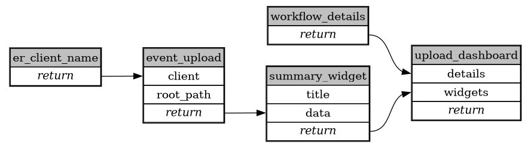

```
# AUTOGENERATED BY ECOSCOPE-WORKFLOWS; see fingerprint in README.md for details

```

```yaml
# fingerprint:
artifacts_sha256_basic: d544c0a8639be9443664c8bf9a5baeeae5fa55e7c1a8aabc6c7e3a8a913ef351
artifacts_sha256_strict: e55e2293d719ef14fe4a92a144da154827d6e0dc3b284c96ba68afa573533697
installed_requirements:
- channel: https://repo.prefix.dev/ecoscope-workflows/
  name: ecoscope-platform
  version: {version: ==2.16.6}
- channel: https://repo.prefix.dev/ecoscope-workflows-gcf/
  name: ecoscope-workflows-ext-gcf
  version: {version: ==0.2.1}
params_sha256: 5c5fdd5edccf86de6fdb4fa2ff374c2412bab8d3fd496a678e3e7b7fbc692b59
spec_sha256: db9ddf046f8409f63db4290872df65bf83938f6dd10e5af83ec03b901006217f

```

# ecoscope-workflows-gcf-event-upload-workflow


